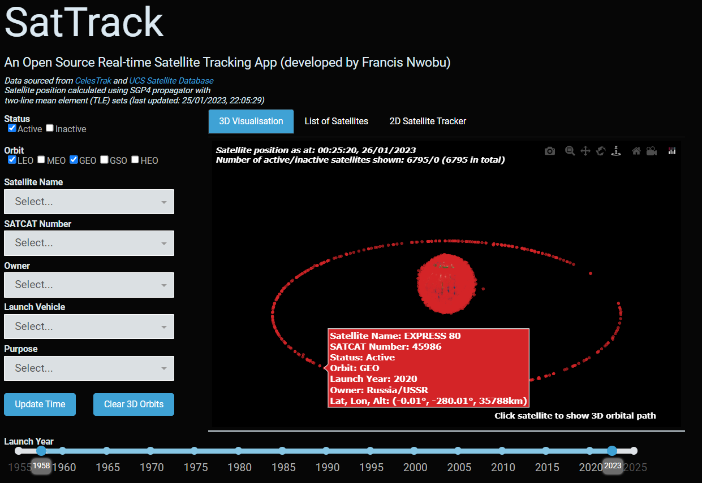
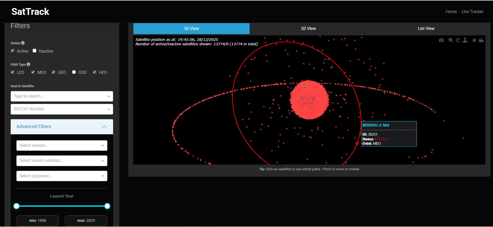

# SatTrack

**Version:** 2.1.0

## Description

This repository contains python scripts to run the SatTrack App - an open-source real-time satellite tracking app - for visualising active and inactive satellites orbiting the Earth. The live app is at [https://www.sattrackapp.com](https://www.sattrackapp.com).

The project consists of two parts - (1) a data pipeline; (2) an interactive app. The interactive app is a Dash app (hosted on Heroku) in which satellite TLE data is converted into a real-time satellite position and satellite catalogue data is used to filter 2d and 3d visualisations. The app also allows satellite position data to be exported in tabular form (to a csv).

The data pipeline (`pipeline/`) ingests Space-Track GP orbital data (USSPACECOM via Space-Track.org) and Jonathan McDowell's GCAT catalogue, and models them with dbt on DuckDB. It runs daily on GitHub Actions with its state in a private S3 bucket (`infra/`), and publishes the app's CSVs there; the app reads them from S3 when it starts. Column definitions and lineage: https://pseud-acc.github.io/SatTrack/

The earlier pipeline (CelesTrak, UCS and space.skyrocket scrapers in `src/`, CSVs committed to `dat/`) was removed in 2.2.0; it is in the git history up to 2.1.0.

## Pipeline/App Features

- 3D visualisation of (current) active/inactive satellite positions
- 3D visualisation of satellite orbital path
- 2D real-time satellite tracker (shows latitude, longitude and altitude)
- Tabular export (to csv) of satellite details and position
- Filters by owner, launch vehicle, purpose, orbit and launch year
- New pipeline: unattended daily ingestion from Space-Track and GCAT, dbt models with tests and documented columns, a health report and data summary per run

## Repository Layout

| Path | What |
|---|---|
| `app/`, `assets/`, `static/`, `run_app.py`, `Procfile`, `pyproject.toml`, `uv.lock` | The Dash app, deployed to Heroku (uv project). See [app/README.md](app/README.md) |
| `pipeline/` | The data pipeline: `ingestion/`, `transform/` (dbt), `scripts/`, `run_pipeline.py`; its own uv project. See [pipeline/README.md](pipeline/README.md) and [pipeline/transform/README.md](pipeline/transform/README.md) |
| `infra/` | AWS CloudFormation stacks and the S3 state helper for the scheduled pipeline; setup in [infra/aws/README.md](infra/aws/README.md) |
| `.github/` | Workflows: `pr.yml` (PR checks), `merge.yml` (checks + Heroku deploy), `pipeline.yml` (daily run), `docs.yml` (docs site), and the shared jobs they call; Dependabot, CODEOWNERS |
| `tests/app_data/` | A small sample of the pipeline's app CSVs, for running the app without AWS (CI, local) |
| `docs/ROADMAP.md` | The feature roadmap (phases 0–7) |
| `CLAUDE.md` | Architecture, commands and working rules for Claude Code and other contributors |

`.slugignore` keeps `pipeline/`, `infra/` and `tests/` out of the Heroku build.

## Requirements

### Python Version
- Python 3.12 or higher

### Dependencies
The app installs only what it imports, plus gunicorn (see [pyproject.toml](pyproject.toml); exact versions in `uv.lock`):
- Dash 2.18
- Dash Bootstrap Components 1.7
- Plotly 5.24
- NumPy 1.26
- Pandas 2.3
- Pillow 10.4
- SGP4 2.25
- gunicorn 20.1 (web server on Heroku)

## Installation

This project uses [uv](https://docs.astral.sh/uv/) for dependency management. The app (repo root) and the
data pipeline (`pipeline/`) are separate uv projects, each with its own `pyproject.toml` and `uv.lock`, so the
Heroku app only ever installs the app's own dependencies.

1. Clone the repository:
   ```bash
   git clone https://github.com/pseud-acc/SatTrack.git
   cd SatTrack
   ```

2. Install uv if you haven't already (see https://docs.astral.sh/uv/getting-started/installation/), e.g.:
   ```bash
   winget install --id=astral-sh.uv -e   # Windows
   ```

3. Create the virtual environment (`.venv/`) with the locked app dependencies and the dev tools:
   ```bash
   uv sync
   ```

## Dependency Management

`pyproject.toml` lists what the app imports, plus gunicorn (the Procfile's web server). `uv.lock` pins
every package, with hashes. Heroku detects `uv.lock` and installs from it with
`uv sync --locked --no-default-groups`, i.e. the app dependencies only, never the `dev` group.

### Updating Dependencies

```bash
uv add <package>            # add an app dependency (updates pyproject.toml and uv.lock)
uv add --dev <package>      # add a dev-only tool (pytest, black, ...)
uv remove <package>
uv lock --upgrade-package <package>   # upgrade one package within its range
```

Commit `pyproject.toml` and `uv.lock` together. `uv lock --check` fails if they're out of step.
Don't add a `requirements.txt` or `poetry.lock` at the repo root: Heroku's Python buildpack stops the
build when it finds more than one package manager file.

## Run Pipeline

**New pipeline (`pipeline/`):** a separate uv project with one dependency group per environment
(`pipeline`, `charts`, `docs`, `bouncer`). In normal operation it runs on GitHub Actions
(`.github/workflows/pipeline.yml`); for a local run:
```bash
cd pipeline
uv sync                      # the `pipeline` group (dbt, DuckDB, ingestion)
uv run python run_pipeline.py --help
```
It needs Space-Track credentials and a private data folder outside the repo (`SATTRACK_DATA_DIR`).

## Run App

The app reads the pipeline's app CSVs (`satcat_tle.csv`, `last_data_update.csv`) from one of two places,
and stops with an error if neither is set:

| Variable | Where the data comes from |
|---|---|
| `SATTRACK_S3_BUCKET` | The private S3 bucket's `app/` folder (Heroku; locally with an AWS login that can read it, e.g. `AWS_PROFILE`) |
| `SATTRACK_APP_DATA_DIR` | A local folder with the two CSVs, e.g. the committed sample `tests/app_data` |

**Using uv:**
```bash
SATTRACK_APP_DATA_DIR=tests/app_data uv run python run_app.py
```

**With the virtual environment activated:**
```bash
python run_app.py
```

The app will be available at http://127.0.0.1:8050/

## Testing Heroku Deployment

Every pull request runs `pr.yml`, and `main` only accepts PRs whose checks pass; `merge.yml` reruns them after a
merge and deploys to Heroku when app files changed. The `app / Heroku build` job
builds the commit with Heroku's own Python buildpack and heroku-24 images, runs it like an Eco dyno (512 MB,
2 workers) on the `tests/app_data` sample, and checks it serves (`.github/scripts/heroku_build_check.sh`).
The options below are for trying the app by hand.

### Local Testing on Windows

**Note:** Gunicorn (Heroku's production server) doesn't work on Windows because it requires Unix-specific modules. Use one of these alternatives:

#### Option 1: Test with Development Server (Current Method)
```bash
SATTRACK_APP_DATA_DIR=tests/app_data uv run python run_app.py
```
Visit http://127.0.0.1:8050/ - If this works, your app should work on Heroku.

#### Option 2: Use Waitress (Windows-Compatible Production Server)
```bash
# waitress is not an app dependency; uv adds it for this one command
SATTRACK_APP_DATA_DIR=tests/app_data uv run --with waitress waitress-serve --listen=*:8000 run_app:server
```
Visit http://localhost:8000 to test.

`bash test_heroku_deployment.sh` checks the files Heroku needs, the lockfile and that the app imports.

### Local Testing on Linux/Mac

If you're on Linux or Mac, you can test with gunicorn directly:

```bash
# Install dependencies (app only, as on Heroku)
uv sync --locked --no-default-groups

# Test with gunicorn (same as Heroku)
SATTRACK_APP_DATA_DIR=tests/app_data uv run gunicorn run_app:server
```
Visit http://localhost:8000 to verify.

### Deploying

Merging a PR into `main` deploys automatically when it changes files that reach the app: `merge.yml` reruns
the checks, uploads the commit through Heroku's Build API, waits for the release and checks the live site
(`.github/workflows/heroku-deploy.yml`). Pipeline-, CI- and docs-only merges don't deploy. To redeploy the
current `main`: Actions → *merge* → *Run workflow* with `force_deploy`.

## Version History

See [CHANGELOG.md](CHANGELOG.md) for detailed version history and release notes.

### Current Version: 2.1.0

#### Latest Updates (2.1.0)
- Dependency management moved from Poetry + `requirements.txt` to uv; the app installs only what it uses (Heroku slug 275 MB → 111 MB)
- The new data pipeline (`pipeline/`) and its AWS infrastructure (`infra/`) now live in this repository
- Fixed the launch-year filter slider stopping at 2025; it now runs to the current year
- Column documentation site: https://pseud-acc.github.io/SatTrack/

#### Key Features (2.0.0)
- Upgraded to Python 3.12
- Poetry dependency management with automated requirements.txt sync (replaced by uv in 2.1.0)
- Real-time satellite position tracking using TLE data
- 3D visualisation of active and inactive satellites
- 2D visualisation of satellite path
- Interactive filters and mobile-optimized interface
- CSV export functionality

#### Planned Improvements (Future Versions)
- See [CHANGELOG.md](CHANGELOG.md) `[Unreleased]` for what is merged but not yet released
- Satellite pass predictor visualisation
- Satellite pass predictor export
- Satellite informational page

## Versioning

This project follows [Semantic Versioning](https://semver.org/):
- **MAJOR** version (`major/` prefix) for incompatible API changes (breaking changes)
- **MINOR** version (`feature/` prefix) for new functionality in a backward-compatible manner
- **PATCH** version (`fix/` prefix) for backward-compatible bug fixes

### PR Naming Convention

Pull requests should be prefixed with the change type:
- `major/` - Breaking changes (e.g., `major/python-version-update`)
- `feature/` - New features (e.g., `feature/satellite-pass-predictor`)
- `fix/` - Bug fixes (e.g., `fix/csv-export-encoding`)
- `docs/` - Documentation updates
- `refactor/` - Code refactoring
- `test/` - Test additions/updates
- `chore/` - Maintenance tasks

See [CHANGELOG.md](CHANGELOG.md) for detailed version history.

## Contributors

**Developer:** Francis Nwobu


## Visualisations

- Screenshots taken from app:







