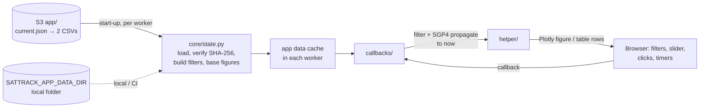

# SatTrack app (`app/`)

The Dash web app at [www.sattrackapp.com](https://www.sattrackapp.com): live 3D and 2D positions of active and
inactive satellites, their orbits, filters, and a table that exports to CSV. It reads the pipeline's satellite
file once at start-up and computes every position itself with SGP4, from each satellite's OMM element set (the
Space-Track GP fields; TLE lines only as a fallback for an older file). Latitude and altitude are on the WGS 84
ellipsoid, as on maps and other trackers.

- **Stack:** Dash 4 + Dash Bootstrap Components 2 (CYBORG theme), Plotly 5, pandas, sgp4; served by gunicorn on a
  Heroku Eco dyno (2 workers × 4 threads, 512 MB).
- **Data:** the pipeline's `satcat_tle.csv` and `last_data_update.csv` (Space-Track + GCAT), from S3 in
  production. See [pipeline/README.md](../pipeline/README.md) for how they're made.

## Contents

- [How it works](#how-it-works)
- [Directory layout](#directory-layout)
- [Pages and callbacks](#pages-and-callbacks)
- [Data](#data)
- [Running locally](#running-locally)
- [Configuration](#configuration)
- [Testing and deployment](#testing-and-deployment)
- [Known issues](#known-issues)

## How it works



1. **Start-up** (`run_app.py`): each gunicorn worker imports the app, which calls `get_app_data()` once. That
   loads the two CSVs, builds the filter options and the static parts of the figures (Earth surface, layouts),
   builds one SGP4 propagator (`Satrec`) per satellite from its OMM fields, and keeps them all in memory for the
   life of the worker.
2. **Requests:** every interaction is a Dash callback. The 3D, 2D and table callbacks filter the satellites,
   propagate the satellites' prebuilt `Satrec`s to the current time in one vectorised SGP4 call, convert to WGS 84
   latitude/longitude/altitude (`helper__satellite_position.py`), and return a new figure or table rows.
3. **Live updates:** timers re-run the 3D callback every 20 s and the 2D callback every 3 s, so positions move
   while the page is open. A 3D timer tick sends only what moved, as a Dash `Patch`: positions, the position part
   of the hover labels, the timestamp and any tracked orbits (about 0.3 MB compressed for ~16,000 satellites).
   Hover labels use one shared template plus per-satellite values (`customdata`), and responses are compressed
   (`Dash(compress=True)`, flask-compress). The `3d-sat-ids` store holds a fingerprint of the satellites drawn, so a
   tick falls back to a full redraw if the set changed.

New data reaches the app only when a worker starts (a deploy, a restart, or the Eco dyno waking from sleep).

### Cesium globe (beta, behind a flag)

Phase 3 replaces the Plotly views with a CesiumJS globe ([docs/cesium-architecture.md](../docs/cesium-architecture.md),
decisions D-013 to D-029, D-038, D-039). Until it is complete it is off unless `SATTRACK_CESIUM_VIEWER=1`; with it off,
nothing below loads and no page changes.

- **Self-hosted packages:** `vendor/cesium.lock` pins CesiumJS and satellite.js with their npm tarball hashes. The
  Heroku build's `bin/post_compile` hook runs `vendor/fetch.py`, which downloads each tarball from the npm registry,
  checks its sha512, extracts only the listed files into `static/vendor/<package>-<version>/` with Brotli and gzip
  copies, and writes `static/vendor/manifest.json`. These files are never committed. At start-up the app checks the
  manifest against the lock and every file's SHA-256; if anything differs the globe stays off and the log says why.
  `GET /static/vendor/<path>` serves only manifest files, pre-compressed, cached for a year (the paths are versioned).
- **Page:** with the flag on, the tracker gets a "Globe (beta)" tab (first, open by default) holding an empty
  `div#globe` that no callback writes to, and four stores: `viewer-config` (same-origin URLs), `viewer-filters` (the
  filter spec, from plan 3.3), `viewer-selection` (from plan 3.4) and `viewer-bridge`. A clientside callback (the
  bridge, `callbacks/callback_viewer.py`) loads `static/viewer/viewer.js` as a module the first time the stores render.
  Viewer code lives in `static/viewer/`, never `assets/` (which Dash loads on every page).
- **Viewer:** `static/viewer/worker.js` fetches `/data/objects.json`, builds satellite.js records from the OMM fields
  and returns Earth-fixed positions on a grid of simulation time (1 s, widened up to 10 s when the worker or the frames
  are slow); `viewer.js` interpolates between samples each frame and moves one `PointPrimitiveCollection`. Objects that
  fail SGP4 are NaN and hidden. Payloads show by default; rocket bodies and debris have toggles and "space junk mode";
  `UNKNOWN` is never shown. The clock is corrected from the server's `Date` header. Every data string is written with
  `textContent`. `window.sattrackViewer` exposes counts, timings and `snapshot(iso)` for the tests.
- **Headers (flag on):** `Content-Security-Policy-Report-Only` and `Strict-Transport-Security: max-age=86400`
  (proposed D-039). Not enforced yet: Cesium 1.147.0 needs `eval` and WebAssembly at load, which needs a decision.

Locally: `python vendor/fetch.py` (add `--out <dir>` and set `SATTRACK_VENDOR_DIR=<dir>` to keep the files out of a
synced folder), then `SATTRACK_CESIUM_VIEWER=1 SATTRACK_APP_DATA_DIR=tests/app_data uv run python run_app.py`.

## Directory layout

| Path | What |
|---|---|
| `../run_app.py` | Production entry point: creates the Dash app (`server` for gunicorn), page template with analytics, URL routing (with a `validation_layout` covering both pages), registers callbacks |
| `../run_app_dev.py` | Local development server with hot reload |
| `core/state.py` | Loads the data (S3 or local folder), builds filters and base figures, caches them (`get_app_data`) |
| `config/user_setup_app.py` | Static paths (Earth map image) |
| `layouts/` | Page layouts: `layout_home.py` (landing page, data sources), `layout_sat_visualisations.py` (tracker), `layout_navbar.py` |
| `layouts/components/` | Tracker building blocks: `header.py` (title, credits, data age), `filter_sidebar.py` + `filters/`, `visualization_area.py` + `visualizations/` (3D, 2D, table tabs) |
| `callbacks/` | One module per area (`callback_3d_viz.py`, `callback_2d_viz.py`, `callback_table.py`, `callback_filters.py`, `callback_navbar.py`), registered by `callback_registry.py` |
| `helper/` | `helper__app_data.py` (filter options, filtering, orbit paths), `helper__satellite_position.py` (`Satrec`s from OMM with TLE fallback, cached; SGP4; TEME → WGS 84 lat/lon/alt; xyz), `helper__plot_display.py` (3D/2D figures, hover labels, camera, orbit clicks), `helper__table_display.py`, `helper__filter_display.py`, `helper__constants.py` |
| `styles/` | Colour palette and component styles |
| `layouts/Archive/` | Earlier layouts, not used |
| `../assets/` | CSS (Bootstrap, `custom.css`) and the Earth map image, served by Dash |

## Pages and callbacks

| Route | Page |
|---|---|
| `/` | Home: what the app does, data sources and their required credits, link to the tracker |
| `/sat_visualisation` | Live tracker: filter sidebar, 3D globe, 2D map and table tabs |

| Callback module | Inputs | Updates |
|---|---|---|
| `callback_3d_viz` | filters, launch-year slider, clicks on a satellite, clear-orbits button, 20 s timer | 3D figure; clicked satellites get their orbit drawn (kept in `3d-orbit-memory`); camera kept in `camera-memory` |
| `callback_2d_viz` | filters, slider, 3 s timer | 2D map |
| `callback_table` | filters, slider | table rows (20 per page, **Export** to CSV) |
| `callback_filters` | status / orbit / owner choices, slider, toggle | name and catalogue-ID dropdown options, advanced-filter panel, year labels |
| `callback_navbar` | URL, menu toggler | active link, collapsed menu |

Filters: status (Active / Inactive), orbit class (LEO, MEO, GEO, GSO, HEO), satellite name, catalogue ID,
owner, launch vehicle class, purpose, launch year range. Defaults: Active, LEO + GEO.

## Data

The app needs two files with these columns (the contract is in the pipeline's `scripts/export_app_csvs.py`):

| File | Contents |
|---|---|
| `satcat_tle.csv` | one row per satellite: `SatCatId`, `ObjectName`, `LaunchYear`, `OrbitalPeriod`, `LaunchMass`, `Inclination`, `Status`, `LaunchSiteCountry`, `Owner`, `UseType`, `Purpose`, `LaunchVehicleClass`, `TLE1`, `TLE2`, `MeanMotion`, `Eccentricity`, `OrbitClass`, then the OMM elements `Epoch` (`%Y-%m-%dT%H:%M:%S.%f`, UTC), `RaOfAscNode`, `ArgOfPericenter`, `MeanAnomaly`, `Bstar`, `MeanMotionDot`, `MeanMotionDdot`, `RevAtEpoch`, `ElementSetNo`, `EphemerisType`, `ClassificationType`, `ObjectId` (with `MeanMotion`, `Eccentricity`, `Inclination`: everything `sgp4.omm.initialize` reads). Positions come from the OMM columns; `TLE1`/`TLE2` may be empty and are used only for a file without the OMM columns |
| `last_data_update.csv` | `Source`, `Last Download`, `Last Update`; the `SpaceTrack_GP` row's update time is shown as "Last updated" |

The pipeline fills gaps in the descriptive fields with `Unknown` / `-1` and exports only satellites with a full element set. The app drops only satellites SGP4 cannot place. Each element set's SGP4 propagator is built once (at start-up) and reused by every callback. Latitude and altitude are geodetic (WGS 84), as on maps; the 3D globe draws them on a sphere.

From S3 the app reads `app/current.json` first: it names the exact object version and SHA-256 of each CSV from
one pipeline run, so the two files always match. A checksum mismatch or a read error stops start-up with a
message that names only the exception type.

Credits shown on both pages (required by the sources' terms): orbital data from USSPACECOM via Space-Track.org,
launch and owner details from GCAT (J. McDowell), and Space-Track's note that public element sets must not be
used for conjunction assessment.

## Running locally

From the repo root, with [uv](https://docs.astral.sh/uv/) and Python 3.12:

```bash
uv sync                                                      # app + dev tools (pytest, black, ...)
SATTRACK_APP_DATA_DIR=tests/app_data uv run python run_app.py
```

Open http://127.0.0.1:8050/. `tests/app_data/` is a 341-satellite sample, enough to try every filter. For the
full live data, use S3 with an AWS login that can read the bucket:

```bash
AWS_PROFILE=admin SATTRACK_S3_BUCKET=<bucket> uv run python run_app.py
```

or download the bucket's `app/` folder and point `SATTRACK_APP_DATA_DIR` at it. With neither variable set the app
stops with an error naming both.

## Configuration

| Variable | Purpose |
|---|---|
| `SATTRACK_S3_BUCKET` | Private bucket to read `app/` from (Heroku). Takes precedence |
| `SATTRACK_APP_DATA_DIR` | Local folder with the two CSVs (local runs, CI) |
| `AWS_ACCESS_KEY_ID`, `AWS_SECRET_ACCESS_KEY` | Heroku: the read-only `sattrack-app-reader` key (S3 `app/*` only). Locally, `AWS_PROFILE` instead |
| `AWS_REGION` | Bucket region, default `eu-west-1` |
| `SATTRACK_CESIUM_VIEWER` | `1` turns on the Cesium globe tab and its security headers (default off) |
| `SATTRACK_VENDOR_DIR` | Local runs and tests only: where `vendor/fetch.py` put the vendor files (default `static/vendor`) |
| `PORT`, `WEB_CONCURRENCY` | Set by Heroku: gunicorn's port and worker count (each worker runs 4 threads: `--threads 4` in the Procfile, so a slow download of a data file holds one thread, not the worker; D-012) |

## Testing and deployment

- **Every PR** runs `app tests / unit + integration`: `tests/app`, on the `tests/app_data` sample with the app's
  clock frozen at the sample's download time. Unit tests call the helpers directly (positions against the sgp4
  library, sidebar filters against an independent pandas filter); integration tests call the server and each
  callback over HTTP as the browser does. Every callback must have a test (`test_every_callback_has_a_test`).
  Run locally: `uv run pytest tests/app -q`.
- **Every merge** first runs `app e2e / browser journeys`: `tests/e2e`, four user journeys in headless Chromium
  against the app on the sample (home → tracker; the 3D view draws the selected satellites; one satellite's 2D
  ground track; the list view), failing on any JS or console error or failed request to the app. Third-party
  requests are blocked (map tiles get a blank image), so the tests need no internet. Checks are by counts and
  rows, so they can carry over to the Cesium viewer. Run locally:
  `uv run --group e2e playwright install chromium` once, then `uv run --group e2e pytest tests/e2e -q`.
  `tests/e2e/test_viewer.py` also starts the app with the Cesium flag on (fetching the vendor files first, into
  `SATTRACK_VENDOR_DIR` if set): globe journeys, parity of the worker's positions with the Python sgp4 library
  (50 m, same failures), the D-027 budget checks a GPU-less runner can make (main-thread ms per frame, first
  positions, heap) on a full-size synthetic catalogue, and no off-site request or unexpected CSP report.
- **Every PR** also runs `app / Heroku build`: the commit is built with Heroku's own buildpack and images, started
  like an Eco dyno on the `tests/app_data` sample, and the pages are checked
  ([`.github/scripts/heroku_build_check.sh`](../.github/scripts/heroku_build_check.sh)).
- **Every merge** that changes app files deploys automatically through `merge.yml`, then checks the live pages
  and that both workers loaded S3 data. Redeploy by hand: Actions → *merge* → *Run workflow* → `force_deploy`.
- `bash test_heroku_deployment.sh` runs the local pre-deploy checks (files, lockfile, app import).

## Known issues

None open. Report problems as GitHub issues.
