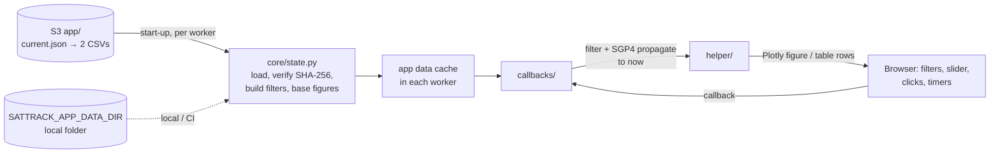

# SatTrack app (`app/`)

The Dash web app at [www.sattrackapp.com](https://www.sattrackapp.com): live 3D and 2D positions of active and
inactive satellites, their orbits, filters, and a table that exports to CSV. It reads the pipeline's satellite
file once at start-up and computes every position itself with SGP4.

- **Stack:** Dash 2 + Dash Bootstrap Components (CYBORG theme), Plotly 5, pandas, sgp4; served by gunicorn on a
  Heroku Eco dyno (2 workers, 512 MB).
- **Data:** the pipeline's `satcat_tle.csv` and `last_data_update.csv` (Space-Track + GCAT), from S3 in
  production. See [pipeline/README.md](../pipeline/README.md) for how they're made.

## Contents

- [How it works](#how-it-works)
- [Directory layout](#directory-layout)
- [Pages and callbacks](#pages-and-callbacks)
- [Data](#data)
- [Running locally](#running-locally)
- [Configuration](#configuration)
- [Testing and deployment](#testing-and-deployment)
- [Known issues](#known-issues)

## How it works



1. **Start-up** (`run_app.py`): each gunicorn worker imports the app, which calls `get_app_data()` once. That
   loads the two CSVs, builds the filter options and the static parts of the figures (Earth surface, layouts),
   and keeps them in memory for the life of the worker.
2. **Requests:** every interaction is a Dash callback. The 3D, 2D and table callbacks filter the satellites,
   propagate each element set to the current time with SGP4 (`helper__satellite_position.py`), and return a
   new figure or table rows.
3. **Live updates:** timers re-run the 3D callback every 20 s and the 2D callback every 3 s, so positions move
   while the page is open. A 3D timer tick sends only what moved, as a Dash `Patch`: positions, the position part
   of the hover labels, the timestamp and any tracked orbits (about 0.3 MB compressed for ~16,000 satellites).
   Hover labels use one shared template plus per-satellite values (`customdata`), and responses are compressed
   (`Dash(compress=True)`, flask-compress). The `3d-sat-ids` store holds a fingerprint of the satellites drawn, so a
   tick falls back to a full redraw if the set changed.

New data reaches the app only when a worker starts (a deploy, a restart, or the Eco dyno waking from sleep).

## Directory layout

| Path | What |
|---|---|
| `../run_app.py` | Production entry point: creates the Dash app (`server` for gunicorn), page template with analytics, URL routing (with a `validation_layout` covering both pages), registers callbacks |
| `../run_app_dev.py` | Local development server with hot reload |
| `core/state.py` | Loads the data (S3 or local folder), builds filters and base figures, caches them (`get_app_data`) |
| `config/user_setup_app.py` | Static paths (Earth map image) |
| `layouts/` | Page layouts: `layout_home.py` (landing page, data sources), `layout_sat_visualisations.py` (tracker), `layout_navbar.py` |
| `layouts/components/` | Tracker building blocks: `header.py` (title, credits, data age), `filter_sidebar.py` + `filters/`, `visualization_area.py` + `visualizations/` (3D, 2D, table tabs) |
| `callbacks/` | One module per area (`callback_3d_viz.py`, `callback_2d_viz.py`, `callback_table.py`, `callback_filters.py`, `callback_navbar.py`), registered by `callback_registry.py` |
| `helper/` | `helper__app_data.py` (filter options, filtering, orbit paths), `helper__satellite_position.py` (SGP4, TEME → lat/lon/alt, xyz), `helper__plot_display.py` (3D/2D figures, hover labels, camera, orbit clicks), `helper__table_display.py`, `helper__filter_display.py`, `helper__constants.py` |
| `styles/` | Colour palette and component styles |
| `layouts/Archive/` | Earlier layouts, not used |
| `../assets/` | CSS (Bootstrap, `custom.css`) and the Earth map image, served by Dash |

## Pages and callbacks

| Route | Page |
|---|---|
| `/` | Home: what the app does, data sources and their required credits, link to the tracker |
| `/sat_visualisation` | Live tracker: filter sidebar, 3D globe, 2D map and table tabs |

| Callback module | Inputs | Updates |
|---|---|---|
| `callback_3d_viz` | filters, launch-year slider, clicks on a satellite, clear-orbits button, 20 s timer | 3D figure; clicked satellites get their orbit drawn (kept in `3d-orbit-memory`); camera kept in `camera-memory` |
| `callback_2d_viz` | filters, slider, 3 s timer | 2D map |
| `callback_table` | filters, slider | table rows (20 per page, **Export** to CSV) |
| `callback_filters` | status / orbit / owner choices, slider, toggle | name and catalogue-ID dropdown options, advanced-filter panel, year labels |
| `callback_navbar` | URL, menu toggler | active link, collapsed menu |

Filters: status (Active / Inactive), orbit class (LEO, MEO, GEO, GSO, HEO), satellite name, catalogue ID,
owner, launch vehicle class, purpose, launch year range. Defaults: Active, LEO + GEO.

## Data

The app needs two files with these columns (the contract is in the pipeline's `scripts/export_app_csvs.py`):

| File | Contents |
|---|---|
| `satcat_tle.csv` | one row per satellite: `SatCatId`, `ObjectName`, `LaunchYear`, `OrbitalPeriod`, `LaunchMass`, `Inclination`, `Status`, `LaunchSiteCountry`, `Owner`, `UseType`, `Purpose`, `LaunchVehicleClass`, `TLE1`, `TLE2`, `MeanMotion`, `Eccentricity`, `OrbitClass` |
| `last_data_update.csv` | `Source`, `Last Download`, `Last Update`; the `SpaceTrack_GP` row's update time is shown as "Last updated" |

Rows with any empty value are dropped, so the pipeline fills gaps with `Unknown` / `-1`.

From S3 the app reads `app/current.json` first: it names the exact object version and SHA-256 of each CSV from
one pipeline run, so the two files always match. A checksum mismatch or a read error stops start-up with a
message that names only the exception type.

Credits shown on both pages (required by the sources' terms): orbital data from USSPACECOM via Space-Track.org,
launch and owner details from GCAT (J. McDowell), and Space-Track's note that public element sets must not be
used for conjunction assessment.

## Running locally

From the repo root, with [uv](https://docs.astral.sh/uv/) and Python 3.12:

```bash
uv sync                                                      # app + dev tools (pytest, black, ...)
SATTRACK_APP_DATA_DIR=tests/app_data uv run python run_app.py
```

Open http://127.0.0.1:8050/. `tests/app_data/` is a 341-satellite sample, enough to try every filter. For the
full live data, use S3 with an AWS login that can read the bucket:

```bash
AWS_PROFILE=admin SATTRACK_S3_BUCKET=<bucket> uv run python run_app.py
```

or download the bucket's `app/` folder and point `SATTRACK_APP_DATA_DIR` at it. With neither variable set the app
stops with an error naming both.

## Configuration

| Variable | Purpose |
|---|---|
| `SATTRACK_S3_BUCKET` | Private bucket to read `app/` from (Heroku). Takes precedence |
| `SATTRACK_APP_DATA_DIR` | Local folder with the two CSVs (local runs, CI) |
| `AWS_ACCESS_KEY_ID`, `AWS_SECRET_ACCESS_KEY` | Heroku: the read-only `sattrack-app-reader` key (S3 `app/*` only). Locally, `AWS_PROFILE` instead |
| `AWS_REGION` | Bucket region, default `eu-west-1` |
| `PORT`, `WEB_CONCURRENCY` | Set by Heroku: gunicorn's port and worker count |

## Testing and deployment

- **Every PR** runs `app tests / unit + integration`: `tests/app`, on the `tests/app_data` sample with the app's
  clock frozen at the sample's download time. Unit tests call the helpers directly (positions against the sgp4
  library, sidebar filters against an independent pandas filter); integration tests call the server and each
  callback over HTTP as the browser does. Every callback must have a test (`test_every_callback_has_a_test`).
  Run locally: `uv run pytest tests/app -q`.
- **Every merge** first runs `app e2e / browser journeys`: `tests/e2e`, four user journeys in headless Chromium
  against the app on the sample (home → tracker; the 3D view draws the selected satellites; one satellite's 2D
  ground track; the list view), failing on any JS or console error or failed request to the app. Third-party
  requests are blocked (map tiles get a blank image), so the tests need no internet. Checks are by counts and
  rows, so they can carry over to the Cesium viewer. Run locally:
  `uv run --group e2e playwright install chromium` once, then `uv run --group e2e pytest tests/e2e -q`.
- **Every PR** also runs `app / Heroku build`: the commit is built with Heroku's own buildpack and images, started
  like an Eco dyno on the `tests/app_data` sample, and the pages are checked
  ([`.github/scripts/heroku_build_check.sh`](../.github/scripts/heroku_build_check.sh)).
- **Every merge** that changes app files deploys automatically through `merge.yml`, then checks the live pages
  and that both workers loaded S3 data. Redeploy by hand: Actions → *merge* → *Run workflow* → `force_deploy`.
- `bash test_heroku_deployment.sh` runs the local pre-deploy checks (files, lockfile, app import).

## Known issues

None open. Report problems as GitHub issues.
