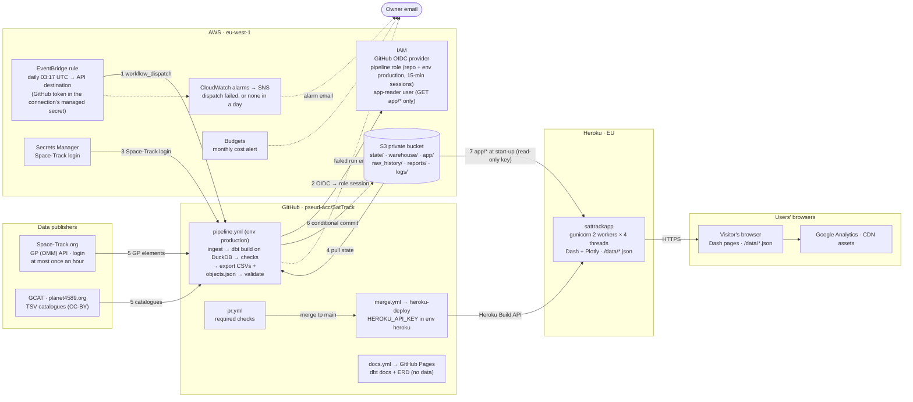

# SatTrack architecture

How the daily pipeline, the AWS account, GitHub, Heroku and the data publishers fit together (as of 22 Nov 2026).
Drawn from `infra/aws/sattrack-core.yaml`, `infra/aws/sattrack-scheduler.yaml`, `.github/workflows/*.yml`, the
`Procfile` and `app/core/`. Update this page in the PR that changes any of them.

Numbered edges are one daily run, in order. Dotted edges are alerts.

## The daily run

1. At 03:17 UTC an EventBridge rule calls GitHub's `workflow_dispatch` API for `pipeline.yml`. It is the only
   trigger: a GitHub `schedule` is disabled after 60 days without activity in a public repo. CloudWatch alarms
   email the owner if the call fails or doesn't happen.
2. The runner swaps its GitHub OIDC token for a 15-minute session in the pipeline role. The role trusts only this
   repo's `production` environment, which only `main` can use.
3. The pipeline reads the Space-Track login from Secrets Manager.
4. It pulls the last committed state (manifest, warehouse) from S3.
5. It downloads Space-Track GP elements (at most once an hour) and the GCAT catalogues, then builds with dbt on
   DuckDB.
6. It validates the export (every `objects` record against `app/contracts/objects.schema.json`) and commits to S3
   with a conditional write, on a fresh 15-minute session. A failed build publishes nothing, so the app keeps the
   last good data, and the job fails, which emails the owner.
7. Each time a dyno starts, the app reads `app/current.json` and the file versions it lists (SHA-256 checked), with
   the read-only app-reader key. New data shows after the dyno next restarts or wakes.

Code reaches users only through the deploy on merge (`merge.yml` → Heroku Build API), and only when files that reach
the app changed. The pipeline never deploys.

## Where each credential lives

| Credential | Stored in | Used by |
|---|---|---|
| Space-Track login | Secrets Manager | the pipeline role only (`GetSecretValue` on that one ARN) |
| AWS access for Actions | nothing stored: OIDC | 15-minute role sessions |
| GitHub token for the dispatch | EventBridge connection (AWS-managed secret) | the EventBridge API destination |
| S3 read key | Heroku config vars | the app, `GET app/*` only |
| `HEROKU_API_KEY` | GitHub environment `heroku` (main only) | the deploy job, from a deploy-only Heroku account |

The `production` environment's secrets hold identifiers only (role ARN, bucket name, secret id), not credentials.

## Guardrails

- PRs, including forks, run under `pull_request` only: read-only token, no secrets, no AWS.
- Every action is pinned to a full commit SHA; every Python install is hash-locked by uv.
- No data in the repo: CI uses the committed sample in `tests/app_data`.
- S3 lifecycle rules expire raw history, logs and old object versions; a monthly AWS budget alerts on cost.

Setup and the threat model: `infra/aws/README.md`. Decisions: `docs/DECISIONS.md`.
