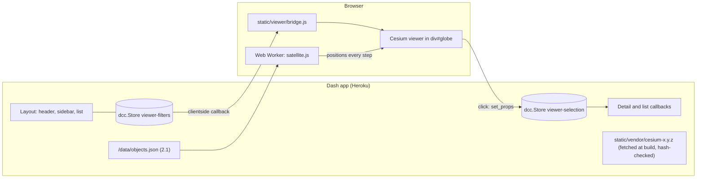

# Cesium viewer architecture

Findings of the Cesium spike (roadmap 3.1) and the architecture Phase 3 builds. The decisions behind it were made
with the owner on 22 Nov 2026 and are recorded as D-013 to D-029 in [DECISIONS.md](DECISIONS.md), each with a full
record in [decisions/](decisions/). The real-phone run on 23 Nov confirmed D-015 and D-027.

## The spike

`docs/cesium-spike/` is throwaway measurement tooling, not part of the app:

- `index.html`: a page that loads `/data/objects.json` (the 2.1 contract), builds satellite.js records from the
  OMM fields and draws every object as a Cesium point. Query options pick the object types, the engine (`js`,
  `wasm`, or `worker` with `wengine=js|wasm` and `step=<seconds>`), the rate and camera spin. Results go to
  `window.spike`.
- `worker.js`: the Web Worker variant. It fetches and parses the data itself and returns Earth-fixed positions as a
  transferred `Float64Array`. The main thread only interpolates between two samples and moves the points.
- `serve.py`: serves the page and a published `objects.json.br`/`.gz` with `Content-Encoding`, as the app does.
- `measure.py`: `parity` compares browser positions with the Python `sgp4` library; `perf` runs the frame-rate
  matrix with the CPU throttled through the DevTools protocol.

Data: the full export of 21 Nov 2026, 32,652 objects (19,742 payloads, 10,179 debris, 2,219 rocket bodies,
512 UNKNOWN); 1.70 MB with Brotli. CesiumJS 1.147.0 and satellite.js 7.1.0. Laptop: Intel Iris Xe, Chromium with
the real GPU (ANGLE on D3D11).

## Findings

### Positions match the Python sgp4 library

`measure.py parity` at 2026-11-22 12:00 UTC, every object, Earth-fixed positions with the same GMST rotation:

| Engine | Compared | Max difference | 99th percentile | Disagreements on failure |
|---|---|---|---|---|
| satellite.js JS, main thread | 32,647 | 9.5 m | 7.4 m | 0 |
| satellite.js WASM, main thread | 32,647 | 9.5 m | 7.4 m | 5 |
| JS in a Web Worker | 32,647 | 9.5 m | 7.4 m | 0 |
| WASM in a Web Worker | 32,647 | 9.5 m | 7.4 m | 5 |

- The few metres are consistent with a ~1 ms difference in time handling (a low-orbit object moves 7.6 m in 1 ms).
  On screen a pixel covers ~15 km at a whole-globe view, so the engines are visually identical to the list view.
- Five objects fail in Python: 45544, 59878 and 101148 with SGP4 error 1 (elements out of range) and 33818 and
  54569 with error 6 (decayed). Plain JS also fails them (NaN). **WASM returns (0, 0, 0)**, the Earth's centre,
  with no error. This was the "5-object discrepancy" seen earlier: JS was right. Any WASM use must treat an exact
  zero vector as a failure.
- The CI parity test (Phase 3) uses this comparison with a 50 m tolerance and requires both sides to fail on the
  same objects.

### Performance

`measure.py perf`: each configuration loaded fresh, 3 s warm-up, then 8 s measured with the camera rotating.
CPU throttling (DevTools protocol) slows the page's main thread 4× (a stand-in for a mid-range phone) or 6×
(low-end); it doesn't slow Web Workers, so worker times below are laptop speed. "Main" is main-thread propagation
work per frame (propagate + move points; for the worker only interpolate + move). Heap is the page's main-thread JS
heap. Single runs on one laptop: indicative.

| CPU | Configuration | Objects | First positions | FPS | Frame p95 | Main ms/frame | Worker ms/pass | Heap MB |
|---|---|---|---|---|---|---|---|---|
| 1× | JS, main thread, every frame | 32,652 | 0.58 s | 32 | 35 ms | 29.9 | – | 117 |
| 1× | WASM, main thread, every frame | 32,652 | 0.88 s | 47 | 25 ms | 20.3 | – | 118 |
| 1× | Worker JS, 1 s + interpolation | 32,652 | 0.84 s | **60** | 18 ms | 2.9 | 51.5 | 48 |
| 1× | Worker WASM, 1 s + interpolation | 32,652 | 1.06 s | **60** | 18 ms | 2.9 | 20.1 | 52 |
| 1× | WASM, main thread, payloads | 19,742 | 0.66 s | 55 | 22 ms | 17.1 | – | 79 |
| 1× | Worker WASM, payloads | 19,742 | 0.81 s | **60** | 18 ms | 2.1 | 13.8 | 31 |
| 4× | JS, main thread, every frame | 32,652 | 4.4 s | 3 | 396 ms | 351 | – | 121 |
| 4× | WASM, main thread, every frame | 32,652 | 9.2 s | 5 | 215 ms | 190 | – | 133 |
| 4× | Worker JS | 32,652 | 1.05 s | 20 | 59 ms | 10.9 | (49.6) | 37 |
| 4× | Worker WASM | 32,652 | 1.34 s | 20 | 60 ms | 10.7 | (24.7) | 50 |
| 4× | WASM, main thread, payloads | 19,742 | 5.3 s | 8 | 149 ms | 123 | – | 96 |
| 4× | Worker WASM, payloads | 19,742 | 1.25 s | **24** | 50 ms | 11.5 | (14.6) | 37 |
| 6× | JS, main thread, every frame | 32,652 | 3.4 s | 2 | 722 ms | 527 | – | 122 |
| 6× | WASM, main thread, every frame | 32,652 | 12.3 s | 7 | 153 ms | 129 | – | 118 |
| 6× | Worker JS | 32,652 | 1.61 s | 24 | 52 ms | 8.9 | (22.9) | 38 |
| 6× | Worker WASM | 32,652 | 1.73 s | 26 | 47 ms | 9.0 | (12.7) | 45 |
| 6× | WASM, main thread, payloads | 19,742 | 4.1 s | 11 | 112 ms | 82 | – | 95 |
| 6× | Worker WASM, payloads | 19,742 | 1.59 s | **32** | 41 ms | 6.2 | (7.6) | 34 |

What this shows:

- **Main-thread propagation is unusable on phones**: 2–11 fps at 4–6× CPU, and first positions take 3–12 s.
  Propagating in a worker gives 20–32 fps and first positions in 1–1.7 s at the same throttling, 3–10× better.
- With the worker, the main thread spends only 2–11 ms a frame on positions. The rest of a throttled frame is
  Cesium's own work (updating 20–33k point positions and drawing). At phone speeds that caps the frame rate in the
  20s–30s, so a 30 fps cap on mobile costs nothing visible. Moving interpolation onto the GPU (review stage 3)
  is the next step if a real phone needs more.
- Payloads only (D-016's default) is the best case: 32 fps at 6×, against 26 fps with every object.
- Worker passes take 13–52 ms at laptop speed; even at 6× (≈80–310 ms) they fit well inside a 1 s step. WASM is
  2–3× faster than JS in the worker, which matters only for fast play speeds (D-015's adaptive step).
- The worker variant's main-thread heap is 31–52 MB, against 79–133 MB when propagating on the main thread
  (the worker's own memory isn't included).
- At run time JS hid 6 objects (the 5 parity failures plus one that failed at that moment); WASM hid 0 because it
  places failures at the Earth's centre.
- Not measured: thermal throttling over minutes of use.

### Real phone

The owner's phone (Qualcomm Adreno 740 GPU, a 2023 flagship chip) over the local network with `serve.py --lan`,
23 Nov 2026: worker with the JS engine, 1 s samples plus interpolation, no frame cap. Read from the page's on-screen
numbers in the owner's screenshots.

| Objects | FPS | Main ms/frame | Worker ms/pass | First positions |
|---|---|---|---|---|
| Payloads, 19,742 (two runs) | 59 / 60 | 1.6 / 2.1 | 22.4 / 23.2 | 0.90 / 1.20 s |
| All objects, 32,652 | 60 | 2.8 | 49.6 | 0.89 s |

The phone performs like the unthrottled laptop and is inside every target of the budget (D-027). It is high-end, so
the throttled laptop runs still stand in for mid-range and low-end phones. The spike page shows Cesium's default
"Cesium ion" credit logo; no ion token is used, and the viewer replaces the credits with SatTrack's own.

### Other findings

- **Import maps don't apply inside Web Workers.** satellite.js's `createSingleThreadRuntime()` imports
  `#wasm-single-thread`, which only an import map resolves. In a worker, import
  `dist/wasm/runtimes/single-thread-runtime.js` and `wasm-build/base-release/index.js` by path and call
  `createSingleThreadRuntimeFromModule` (async). Self-hosting (D-014) serves both from `static/`.
- **No Cesium ion.** Natural Earth II ships with Cesium and loads with `TileMapServiceImageryProvider`: no account
  and no token.
- **Load.** Cesium.js is 1.54 MB with Brotli from the CDN; the data file 1.70 MB. The built Cesium folder is
  22.8 MB; the subset the viewer needs (no duplicate bundles, 3D-tiles decoders or precession tables) is about
  10.2 MB in 308 files, of which the browser downloads only what it uses.

## Architecture

- **Dash stays the shell** (D-013). The globe is an empty `html.Div(id="globe")` that no callback ever writes to.
  `static/viewer/` code, loaded only on the tracker page, mounts the viewer. Filters reach it through a
  `dcc.Store` and a clientside callback; a click goes back with `dash_clientside.set_props`. Viewer code lives in
  `static/`, never `assets/`, which Dash loads on every page.
- **Cesium and satellite.js are self-hosted** (D-014): `vendor/cesium.lock` pins versions and the npm tarball
  hashes; a script run by the Heroku and CI builds downloads, verifies and extracts the files used into a versioned
  `static/vendor/` path served with long-lived caching. A hash mismatch fails the build and the live release stays.
- **Propagation runs in a Web Worker** (D-015): the worker computes all positions on a fixed grid of
  simulation time; the main thread interpolates linearly between the two samples around the current time. Linear
  interpolation over 1 s is off by ~1 m in low orbit (midpoint error s²/8R), 110 m over 10 s. A small controller
  widens the step (0.25–10 s of simulation time) when the device is slow or play speed is high.
- **Engine** (D-029): the worker hides satellite.js behind `compute(dates) → positions`. 3.2 ships the JavaScript
  `propagate()` (correct NaN on failure, no `'wasm-unsafe-eval'`); the WASM `BulkPropagator` replaces it when
  day/night shadow dimming is built, adding the zero-vector guard, a parity-test row and the CSP entry.
- **Rendering**: one `PointPrimitiveCollection` for all objects; one viewer for 3D, 2D and Columbus (D-021).

## UX decisions (summary)

| # | Decision | Answer |
|---|---|---|
| D-016 | Default object set | Payloads; toggles for rocket bodies and debris and a "space junk mode" switch for both |
| D-017 | Colour | By type by default; "Colour by" orbit class, status, owner or major constellation, with a legend |
| D-018 | Information tiers | Hover label → click panel → full record in the list view |
| D-019 | Selection | Single selection; panel toggles for orbit path (one period, past faded), follow camera, ground track (2D) |
| D-020 | Time | Own scrubber ±1 day, Now, play speeds 1×–1000×; element age at the displayed time |
| D-021 | 2D | One viewer for 3D, 2D and Columbus; the Plotly 2D tab is retired |
| D-022 | Earth | Natural colour, self-hosted Natural Earth II (provisional: revisit with point styling) |
| D-023 | Labels | Selected satellite, plus the ~20 nearest when zoomed in |
| D-024 | Shareable links | Core view in the URL hash: satellite, time, mode, colour, type toggles |
| D-025 | Mobile | Bottom sheet over a full-screen globe |
| D-026 | Constellations | CelesTrak's constellation and operator groups via the pipeline, credited "Constellation groups: CelesTrak (Dr T.S. Kelso)"; GCAT rule as the fallback; a manual workflow (#62) for local test data |
| D-027 | Performance budget | Laptop 60 fps, main ≤ 5 ms, first positions ≤ 1.5 s, heap ≤ 80 MB; 4× payloads ≥ 24 fps; 6× all ≥ 20 fps; phones capped at 30 fps |
| D-028 | Phase 3 scope | Core plus search and fly-to, save image (PNG), constellation colouring, day/night with shadow dimming |
| D-029 | Engine | JS in the worker now; WASM when shadow dimming lands |

## Before the Cesium viewer is on by default

Blockers: propagation off the main thread on phones (D-015); self-hosting instead of a CDN (D-014); the CI parity
test, including failures; the Space-Track citation and conjunction caution in the viewer's credits. Must-dos: a
Content-Security-Policy (report-only first; `worker-src 'self'`, `'wasm-unsafe-eval'` if WASM), HSTS, `textContent`
for every data string, credits for CesiumJS (Apache-2.0), satellite.js (MIT), Natural Earth (public domain),
GCAT (CC-BY) and the CelesTrak groups (D-026), a clock-offset from the server's `Date` header, and element age shown in the panel.

## Changes to the roadmap's Phase 3 text

The roadmap's Phase 3 notes predate these decisions. Superseded: viewer JS in `assets/` (now `static/`), CesiumJS
from a CDN (now self-hosted, ~10 MB on the slug, so the "slug not materially increased" check becomes "within
15 MB"), an optional ion token (none), colour by orbit class / status (by type, with a menu), and "smooth on a
mid-range laptop with payloads + debris" (now the measured budget, D-027). The roadmap's Phase 3 text is updated
in the same PR as this document.
