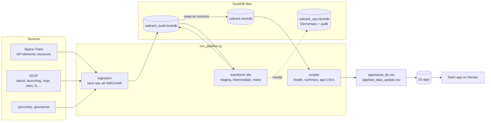

# SatTrack data pipeline

Builds the satellite data behind [SatTrack](https://www.sattrackapp.com): it downloads orbital elements from
Space-Track and launch/owner details from GCAT, models them with dbt on DuckDB, and publishes the two CSV files
the Dash app reads, plus a health page and a data summary report.

- **Runs:** once a day on GitHub Actions ([`pipeline.yml`](../.github/workflows/pipeline.yml)); state lives in a
  private S3 bucket ([`infra/`](../infra/aws/README.md)).
- **Unattended and fail-closed:** a stage that fails keeps the last good data; the app never sees a half-built
  database.
- **Documented columns:** every column's definition is quoted from the publisher and cited. Docs site:
  https://pseud-acc.github.io/SatTrack/

## Contents

- [Architecture](#architecture)
- [Directory layout](#directory-layout)
- [What a run does](#what-a-run-does)
- [Outputs](#outputs)
- [Running it](#running-it)
- [Configuration](#configuration)
- [Testing and checks](#testing-and-checks)
- [Data sources and terms](#data-sources-and-terms)

## Architecture



On GitHub Actions the run is wrapped by [`infra/state/sattrack_state.py`](../infra/state/sattrack_state.py):
`pull` downloads the last committed DuckDB files from S3 before the run, and `push` promotes the new ones
(and the app CSVs) only when the run succeeded. The app reads `app/current.json`, which names the exact object
versions of a matching pair of CSVs.

## Directory layout

| Path | What |
|---|---|
| `run_pipeline.py` | The entry point: runs every stage in order (below) and writes the run log |
| `ingestion/sattrack_ingest/` | Python package that fetches each source and lands it raw (`extractors.py`, `raw_writer.py`), Space-Track credentials (`credentials.py`), the audit tables (`audit.py`), the run log (`runlog.py`), paths (`config.py`) |
| `ingestion/tests/` | pytest suites for credentials, audit flags and the run log |
| `transform/` | The dbt project: models, tests, macros, analyses, docs. See [transform/README.md](transform/README.md) |
| `scripts/` | Report builders run after dbt: `build_health_page.py`, `build_data_summary.py`, `export_app_csvs.py`; docs helpers `build_docs_registry.py`, `codegen_contracts.py`, `erd/` (docs-site diagram) |
| `docs/column_definitions/` | The sourced column definitions (review copy); `scripts/build_docs_registry.py` turns them into the dbt doc blocks in `transform/docs/columns/` |
| `pyproject.toml`, `uv.lock` | One uv project, four environments (dependency groups), below |

The pipeline is separate from the app: its packages never reach Heroku (`.slugignore` drops `pipeline/`).

## What a run does

`run_pipeline.py` works on a **copy** of the live database and only replaces the live file at the end.

| # | Stage | What happens | On failure |
|---|---|---|---|
| 1 | Working copy | Copies `sattrack.duckdb` to `sattrack_build.duckdb` | — |
| 2 | Ingest | Space-Track (GP + boxscore), GCAT (9 TSV files + code labels), pycountry, geonames are landed unchanged into `raw_*` schemas, each with load metadata; every call is logged to `audit.ingestion_call`. A copy of each raw table goes to `raw_history/` (Parquet, 90 days) | The dbt unit that needs the source is **held** |
| 2b | Source freshness | `dbt source freshness`, recorded in `audit.source_freshness` | Warn only |
| 3 | dbt build | Two **swap units** in order: `tracking` (GP elements → `marts_tracking`), then `enrichment` (GCAT + reference data → `marts`). Each is `dbt build --selector <unit>`, so its models and tests run together | A failing unit is held; enrichment is held whenever tracking fails |
| 4 | Publish | A held unit's marts are restored from the live file, so it keeps its last good build | — |
| 4b | Orphan cleanup | Drops tables of models that were renamed or removed | — |
| 5 | Swap | Renames the build file over `sattrack.duckdb`; records row counts and the run in `audit.*` | — |
| 6–8 | Reports | Health page, data summary, app CSV export. Each one keeps its last good output on error | Never fails the run |

The run's result is `ok` (both units published), `warn` (one unit held, or a stage warned) or `error` (no unit
published). Exit codes: `0` for ok/warn, `1` for error, `3` when a local run is refused (see the guard below).

Source limits are built in: a landed copy younger than its limit is reused instead of downloaded again
(Space-Track GP 55 minutes, boxscore 23 hours, GCAT 6 hours). After 3 consecutive failed Space-Track logins,
runs stop trying to log in, so an unattended job can't get the account locked, and keep the last good tracking
data until the counter in `audit.login_state` (ops database) is reset by hand.

## Outputs

Everything is written under the data folder (`SATTRACK_DATA_DIR`, default `pipeline/data/`, git-ignored):

```text
<data dir>/
├── warehouse/
│   ├── sattrack.duckdb          live database: raw_*, staging, intermediate, marts, marts_tracking
│   ├── sattrack_build.duckdb    the run's working copy (renamed over the live file at the end)
│   └── sattrack_ops.duckdb      permanent: Elementary results + audit.* run history
├── raw_history/<schema>/<table>/<run_id>.parquet    raw copies, kept 90 days
├── app/
│   ├── satcat_tle.csv           one row per tracked satellite with its element set (OMM + TLE; what the app plots)
│   ├── last_data_update.csv     freshness rows: SpaceTrack_GP, GCAT
│   ├── objects.json.br / .gz    the browser's objects dataset, pre-compressed (docs/app-data-contract.md)
│   └── manifest.json            rows, SHA-256 and as-of dates of every file above
├── health/health.html, health.json      pipeline health page
├── reports/data_summary.html            data summary dashboard (dbt Charts)
└── logs/YYYY/MM/DD/<run_id>.log         run summary: command, stage results, mart row changes
```

In production the same files are kept in S3 (`warehouse/`, `app/`, `reports/`, `raw_history/`, `logs/`); the
run log goes to S3 only, never to the public Actions log. The workflow's last step prints a short public run report
(result, stage statuses, names of checks not passing, data dates) and fails the job on any problem, so GitHub
emails the owner: see `.github/scripts/pipeline_report.py`.

## Running it

In production nothing needs running by hand: the workflow is dispatched daily (or from Actions →
*sattrack-pipeline* → *Run workflow*, with `dry_run` to run without committing anything).

### Setup

Requires [uv](https://docs.astral.sh/uv/) and Python 3.12. From `pipeline/`:

```bash
uv sync                          # the `pipeline` environment: dbt-oss 2.0.8, DuckDB 2.0, ingestion
cd transform && uv run dbt deps --profiles-dir . && cd ..    # dbt packages (dbt_utils, elementary, ...)
```

The four environments in `uv.lock` are mutually exclusive, so each gets its own folder:

| Group | Used for | Install |
|---|---|---|
| `pipeline` | ingestion, dbt build, health page, app export | `uv sync` (default) |
| `charts` | data summary dashboard (dbt-charts) | `UV_PROJECT_ENVIRONMENT=.venv-charts uv sync --only-group charts` |
| `docs` | docs-site ERD (dbterd) | `UV_PROJECT_ENVIRONMENT=.venv-docs uv sync --only-group docs` |
| `bouncer` | dbt-bouncer and the pytest suites (needs DuckDB < 2) | `UV_PROJECT_ENVIRONMENT=.venv-bouncer uv sync --only-group bouncer` |

### A local run

```bash
export SATTRACK_DATA_DIR=/path/outside/the/repo     # private: holds the warehouse and outputs
export SPACETRACK_USER=... SPACETRACK_PASS=...      # e.g. from a git-ignored .env.sh
uv run python run_pipeline.py                       # add --quiet for a one-line summary
```

A local run calls Space-Track for real and counts against its limits. Once the scheduled run is live, an
empty file named `remote_live` in the data folder makes local runs refuse to start (exit 3) unless
`--allow-local` is given. For local work on the app or the models, download a copy of the state instead:
the app runs from `tests/app_data/` or a downloaded `app/` folder (see the root README).

### dbt on its own

To iterate on models against an existing warehouse copy (no downloads), see
[transform/README.md](transform/README.md#running-dbt).

## Configuration

| Variable | Default | Purpose |
|---|---|---|
| `SATTRACK_DATA_DIR` | `pipeline/data` | Data folder (warehouse, outputs, logs) |
| `SPACETRACK_USER`, `SPACETRACK_PASS` | — | Space-Track login for local runs |
| `SATTRACK_SPACETRACK_SECRET_ID` | — | AWS Secrets Manager secret (ARN) with the login; the only source in CI |
| `SATTRACK_CREDENTIAL_SOURCE` | — | `secretsmanager` to ignore env-var credentials (always the case in CI) |
| `SATTRACK_DBT_BIN` | `dbt` | dbt executable |
| `SATTRACK_REPORTS_PYTHON` | — | Python of the `charts` environment; without it the data summary is skipped |
| `SATTRACK_RAW_HISTORY_DAYS` | `90` | Raw-history retention |
| `SATTRACK_QUIET` | — | `1` = `--quiet` |
| `SATTRACK_ALLOW_LOCAL` | — | `1` = `--allow-local` |
| `SATTRACK_TRIGGER`, `SATTRACK_GIT_SHA` | `manual`, — | Recorded in `audit.pipeline_run` (set by the workflow) |

Credentials are never logged; error text in logs and audit tables is scrubbed of URLs, tokens and paths.

## Testing and checks

Every pull request runs these in CI ([`pipeline-checks.yml`](../.github/workflows/pipeline-checks.yml)), with no
data or secrets needed:

```bash
# from pipeline/, in the bouncer environment
.venv-bouncer/bin/python -m pytest ingestion/tests -q -p no:cacheprovider
cd transform
../.venv-bouncer/bin/python -m pytest bouncer/tests -q -p no:cacheprovider
dbt parse --profiles-dir .                                   # pipeline environment
../.venv-bouncer/bin/dbt-bouncer --config-file bouncer/dbt-bouncer.yml
```

(On Windows the environment's executables are under `Scripts\` instead of `bin/`.) Each run also executes the
dbt data tests and Elementary checks inside `dbt build`; their results are on the health page.

## Data sources and terms

| Source | Data | Terms |
|---|---|---|
| [Space-Track.org](https://www.space-track.org/) (USSPACECOM) | GP orbital elements, SATCAT fields, country boxscore | Basic SSA data; credit "USSPACECOM via Space-Track.org"; public element sets must not be used for conjunction assessment |
| [GCAT](https://planet4589.org/space/gcat/) (J. McDowell) | satellite, launch, organisation, site and launch-vehicle catalogues | Credit GCAT (J. McDowell) |
| [pycountry](https://pypi.org/project/pycountry/) | ISO 3166 countries | LGPL-2.1 |
| [GeoNames](https://www.geonames.org/) via geonamescache | cities, countries | CC BY 4.0 |
