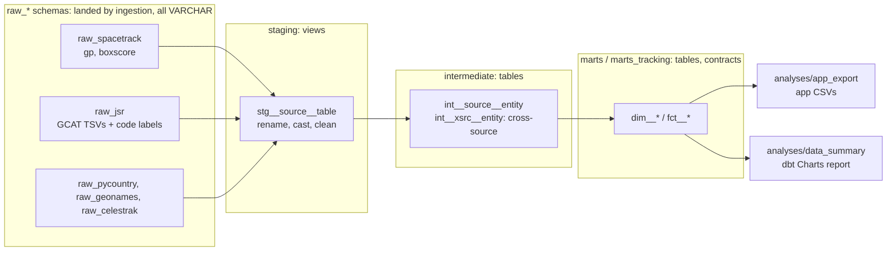

# SatTrack dbt project (`transform/`)

The modelling layer of the [SatTrack pipeline](../README.md). It turns the raw Space-Track, GCAT and reference
tables that ingestion lands in DuckDB into documented, tested marts, and defines the queries behind the app's
CSV files and the data summary report.

- **Engine:** dbt-oss 2.0.8 with the DuckDB adapter; one DuckDB file per run (`sattrack_build.duckdb`), plus an
  attached ops database for Elementary and audit results.
- **Docs site** (models, columns, lineage, ERD of the marts): https://pseud-acc.github.io/SatTrack/

## Contents

- [How the layers fit together](#how-the-layers-fit-together)
- [Swap units](#swap-units)
- [Directory layout](#directory-layout)
- [Conventions](#conventions)
- [Tests and rules](#tests-and-rules)
- [Outputs](#outputs)
- [Running dbt](#running-dbt)
- [Documentation](#documentation)

## How the layers fit together



| Layer | Folder | Materialised as | Schema | Job |
|---|---|---|---|---|
| Sources | `models/staging/*/_<source>__sources.yml` | — | `raw_spacetrack`, `raw_jsr`, `raw_pycountry`, `raw_geonames`, `raw_celestrak` | Declares the raw tables, their freshness rules and load metadata |
| Staging | `models/staging/<source>/` | view | `staging` | One model per raw table: rename to snake_case, cast types, clean text, parse GCAT's vague dates. No joins |
| Intermediate | `models/intermediate/<entity>/` | table | `intermediate` | Business logic: de-duplication, mapping tables, matching GCAT to Space-Track (`int__xsrc__*`) |
| Marts | `models/marts/<entity>/` | table, **contract enforced** | `marts`, `marts_tracking` | What consumers read: dimensions and facts that only assemble intermediate models |

The 11 marts, by folder:

| Folder | Marts |
|---|---|
| `tracking` | `fct__gp_elements`: newest GP element set per tracked object |
| `satellite` | `fct__satellite_master`: one row per satellite, GCAT details joined to Space-Track; feeds the app |
| `launch` | `dim__launch_site`, `dim__launch_vehicle`, `fct__launch_event` |
| `organisation` | `dim__org`, `fct__launch_agency_org`, `fct__satellite_manufacturer_org`, `fct__satellite_owner_org` |
| `geography` | `dim__country`, `fct__satellite_owner_country` |

Their relationships are drawn in the ERD on the docs site.

## Swap units

Models are tagged into two units that build and publish independently (`selectors.yml`), so a GCAT problem
never stops satellite positions from updating:

| Unit | Tag | Builds | Publishes to |
|---|---|---|---|
| `tracking` | `tracking` | Space-Track staging, `int__spacetrack__*`, `fct__gp_elements` | `marts_tracking` |
| `enrichment` | `enrichment` | GCAT, pycountry, geonames and CelesTrak models and the satellite, launch, organisation and geography marts | `marts` |

`run_pipeline.py` runs `dbt build --selector tracking`, then `--selector enrichment` (held if tracking failed),
with `--indirect-selection buildable` so a test that spans both units runs only with the second. A unit whose
models or tests fail is restored from the previous live database instead of published. Elementary's own models
run with both units.

## Directory layout

| Path | What |
|---|---|
| `dbt_project.yml` | Layer materialisations, schemas, unit tags; var `min_jsr_match_rate` (0.97) |
| `profiles.yml` | DuckDB connection: `SATTRACK_DB_PATH` (build DB) and `SATTRACK_OPS_PATH` (attached as `ops`) |
| `selectors.yml` | The `tracking` and `enrichment` units |
| `packages.yml`, `package-lock.yml` | dbt_utils, dbt_expectations, audit_helper, elementary |
| `models/staging/` | `spacetrack/`, `jsr/` (GCAT), `pycountry/`, `geonames/`, `celestrak/` (constellation groups, D-026): sources + staging models |
| `models/intermediate/` | `tracking/`, `satellite/`, `launch/`, `organisation/`, `geography/` |
| `models/marts/` | the same five areas, one `_<area>__schema.yml` each with contracts and tests |
| `macros/` | `helper__*` macros by area: GCAT parsing (vague dates, text cleaning, casts), geography keys and distances, launch-vehicle brand, org-code lists, orbit class; `project/` holds `generate_schema_name` and `helper__audit_fields`; `elementary/` holds DuckDB fixes for Elementary |
| `tests/generic/`, `tests/singular/` | the `model_health` generic test; singular tests for GCAT match rate, owner-country rules, launch and status precedence, vague-date parsing |
| `analyses/app_export/` | `app__satcat_tle.sql`, `app__last_data_update.sql`: the app's CSV queries, run by `scripts/export_app_csvs.py` |
| `analyses/data_summary/` | `ds__<tab>__<panel>.sql`: one query per panel of the data summary report |
| `analyses/migration/` | one-off parity checks kept for reference |
| `charts/`, `dbt_charts.yml` | dbt Charts definition of the data summary report (`charts/_generated/` is build output) |
| `docs/` | `overview.md` (docs-site home), `sources.md` (source and table descriptions), `columns/*.md` (one doc block per column) |
| `bouncer/` | dbt-bouncer rules (`dbt-bouncer.yml`), bespoke checks (`bespoke/manifest/`) and their tests |

## Conventions

These are enforced by dbt-bouncer (`bouncer/dbt-bouncer.yml`), so a PR that breaks one fails CI.

- **Names:** `stg__<source>__<table>`, `int__<source>__<entity>` (`xsrc` when it combines sources),
  `dim__<entity>` / `fct__<subject>`; tests `assert__<model>__<what>`; macros `helper__<what it does>`; properties
  files `_<folder>__schema.yml`, `_<source>__sources.yml`.
- **Model SQL layout:** one `cte_<model>` per `ref()` with its columns listed explicitly (no `select *` from a
  ref), named CTEs for each transformation step, then `cte_final` with an explicit cast on every column and
  `{{ helper__audit_fields() }}`, ending in `select * from cte_final`. Columns are always written out, never
  generated from contracts.
- **Layering:** each staging model reads exactly one source and only renames, casts and cleans; intermediate
  models read staging or intermediate; marts read intermediate only and only assemble (joins and defaults).
- **Audit fields:** every model ends with `helper__audit_fields()`: `inserted_date_time` (build time) and
  `inserted_by` (the run id, `manual` outside the pipeline).
- **Documentation:** every column in every properties file has a description pointing to a doc block in
  `docs/columns/`; every definition quotes or closely paraphrases the publisher and cites it.

## Tests and rules

| Kind | Where | When it runs |
|---|---|---|
| Column and model tests (unique, not_null, accepted_values, `fk__*` relationships, dbt_expectations) | properties files | every `dbt build`, i.e. every pipeline run; an error-severity failure holds the unit |
| Singular tests | `tests/singular/` | every `dbt build` |
| Contracts | marts `_<area>__schema.yml` | every build: a mart whose columns or types drift fails |
| Source freshness | `_<source>__sources.yml` | every pipeline run, warn only |
| Elementary monitors and results | `elementary` package, ops DB | every build; shown on the health page |
| dbt-bouncer project rules (2,300+ checks in 10 groups: naming, materialisation, audit, lineage, marts, tests, docs, SQL style, sources, macros) | `bouncer/dbt-bouncer.yml` | CI on every PR, after `dbt parse` |
| Unit tests for the bespoke bouncer checks | `bouncer/tests/` ([README](bouncer/tests/README.md)) | CI on every PR |

## Outputs

In the DuckDB file the pipeline publishes (`sattrack.duckdb`):

| Schema | Contents |
|---|---|
| `raw_*` | the landed source tables, unchanged (from ingestion) |
| `staging` | views over the raw tables |
| `intermediate` | intermediate tables |
| `marts`, `marts_tracking` | the published marts (contract enforced) |

dbt also writes Elementary's tables to the attached ops database, and `target/` holds run artifacts
(manifest, run results); `target/` and `dbt_packages/` are git-ignored.

## Running dbt

Use the `pipeline` uv environment (see [the pipeline README](../README.md#setup)). From `pipeline/transform/`:

```bash
export SATTRACK_DB_PATH=/path/to/sattrack_build.duckdb      # a copy of a warehouse, never the live file
export SATTRACK_OPS_PATH=/path/to/sattrack_ops.duckdb
uv run dbt deps --profiles-dir .
uv run dbt build --selector tracking --profiles-dir .        # or: --select fct__satellite_master+
uv run dbt show --select app__satcat_tle --profiles-dir .    # preview an analysis
```

`dbt parse` needs no data at all (an empty DuckDB path is enough), which is how CI checks the project.
To get a warehouse copy, download `warehouse/` from the S3 state with an admin login, or run the whole
pipeline locally ([pipeline README](../README.md#a-local-run)); dbt alone never calls the sources.

The docs site is built by [`docs.yml`](../../.github/workflows/docs.yml) against an empty database:

```bash
uv run dbt docs generate --profiles-dir . --target-path ../data/docs_target --write-catalog --output-dir ../data/site
```

## Documentation

- Column definitions are written and reviewed in `../docs/column_definitions/` (cited, one table per source
  table), then turned into doc blocks in `docs/columns/` by `../scripts/build_docs_registry.py`.
- `docs/sources.md` describes each source and table; `docs/overview.md` is the docs-site home page with the
  marts ERD (built from the `fk__*` tests by `../scripts/erd/build_erd.sh`).
